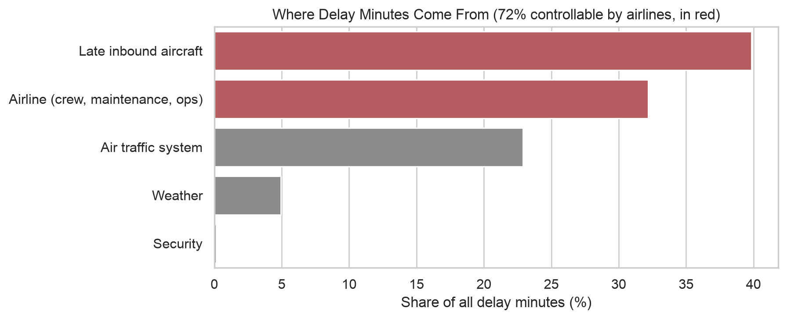
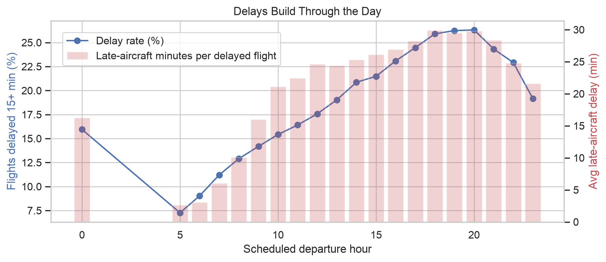
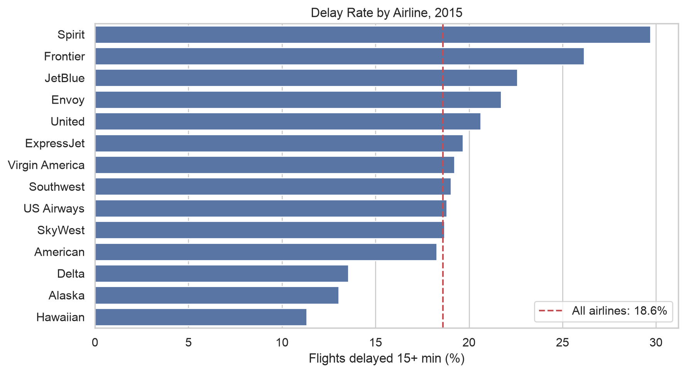
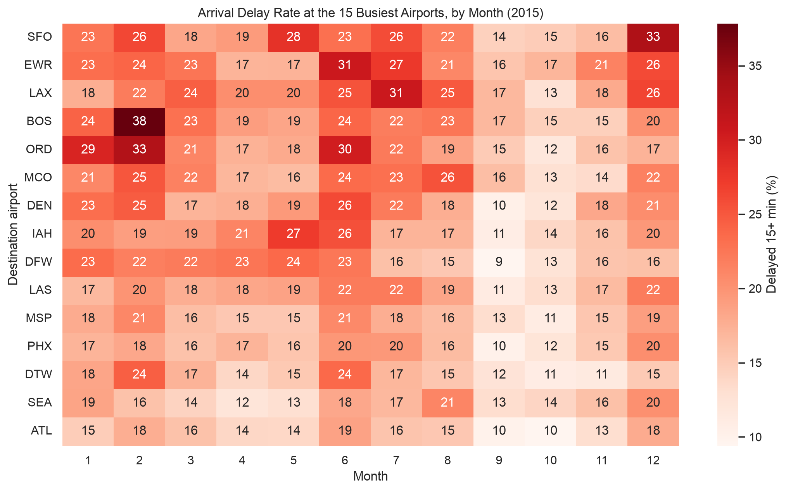

# When and Why Do U.S. Flights Run Late?

An analysis of all 5.8 million U.S. domestic flights in 2015 (DOT on-time performance data) to find out who runs late, when, and why, and how much of it airlines could actually control.

## Key findings

**1. 72% of delay minutes are controllable by airlines.** Late inbound aircraft (39.8%) and the airline's own operations (32.2%) cause most delay time. Weather is only 4.9%.



**2. Delays snowball through the day.** Flights leaving 5-8pm are delayed 2.5x as often as flights leaving 5-8am (25.7% vs. 10.1%). A delayed 6am flight carries about 3 minutes of late-aircraft delay, while a delayed 6pm flight carries about 30, because every late plane passes its delay down to the next flight.



**3. Airline matters more than airport.** Delay rates range from 11.3% (Hawaiian) to 29.7% (Spirit), a 2.6x gap. Among the 15 busiest airports the gap is much smaller (14.7% at Atlanta to 22.0% at San Francisco and Newark).



**4. Summer and winter storms are the worst months, fall is the calmest.** June was the worst month overall (23.5% delayed), and February spiked to 38% at Boston. October was the best month (12.4%).



**So what:** for an airline, the biggest lever is operations, not weather. Protect the first wave of morning departures, add turnaround buffer on afternoon and evening rotations, and benchmark against Delta and Alaska, who run large networks at roughly half Spirit's delay rate.

## Data cleaning worth knowing about

- **October was missing.** The raw file stores every October airport as a numeric DOT ID (`10397`) instead of an airport code (`ATL`), so October silently dropped out of any airport or route analysis. I rebuilt the mapping from the data itself: the same airline, flight number, and distance in September and November flies the same route. That mapped 305 airports and recovered 99.97% of October's 486,165 flights.
- **"Delayed" means 15+ minutes.** I use the DOT and airline industry standard. Counting any flight that's even 1 minute late would nearly double the delay rate (36.5% vs. 18.6%).
- **Cancelled and diverted flights** aren't counted as on time or late, since they never arrived.

## Project structure

```
├── notebooks/
│   ├── 01_data_setup.ipynb       where the data comes from, the October fix, completeness checks
│   └── 02_delay_analysis.ipynb   four hypotheses, four charts, findings
├── src/load_data.py              shared loading and cleaning used by every notebook
├── figures/                      charts saved by the notebooks
└── requirements.txt
```

## How to run it

1. Download `flights.csv` from [Kaggle: usdot/flight-delays](https://www.kaggle.com/datasets/usdot/flight-delays) and put it in a `data/` folder at the top of the repo
2. `pip install -r requirements.txt`
3. Run the notebooks in order

## Limitations and next steps

This covers one year (2015). US Airways and Virgin America have since merged into other airlines, so the next step is re-running the same pipeline on recent BTS data to see whether these patterns still hold.

*Started as my final project for DS 2023 at the University of Virginia, then extended on my own with the October fix, the 15-minute standard, and the delay-cause analysis.*

**Data source:** U.S. Department of Transportation, Bureau of Transportation Statistics, Airline On-Time Performance.